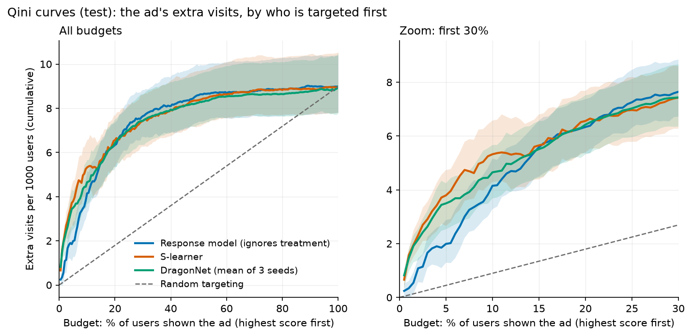
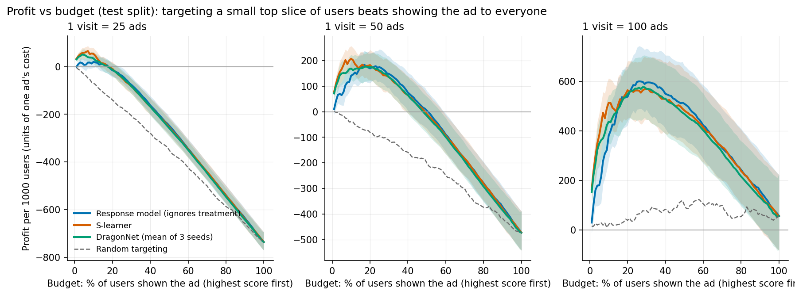
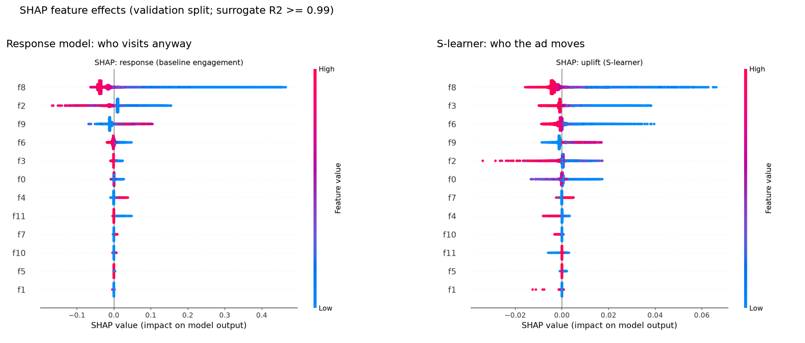

# Who should see the ad? Uplift modeling on Criteo Uplift v2.1

A pre-registered benchmark of seven uplift approaches on a randomized advertising experiment: does a better causal model actually make a better targeting decision, or does a simple "who visits anyway" model do just as well?

**Short answer:** the ad works, but almost all of its effect sits in the top 10 to 20% of users, and that group is easy to find. All seven approaches, including TARNet and DragonNet, performed within statistical noise of a plain response model on the held-out test split. The one comparison declared in advance (S-learner vs response model, profit) came out in the S-learner's favour, but the edge is small.

## Key findings

- **The ad's effect is real but concentrated.** On the validation split, the highest-scored 10% of users show a +5.5 to +6.4 percentage-point rise in visit probability when shown the ad. Deciles 4 to 10 show roughly zero. The effect scales with how often a user would visit anyway.
- **Targeting beats showing the ad to everyone.** Treating all users loses 472 ad-costs per 1000 users when one visit is worth 50 ads. Targeting the top 10 to 17% of users, by any of the models, earns about +170 to +190 per 1000 users on the test split.
- **Model choice barely matters for ranking quality.** Qini AUC on test ranges from 0.081 to 0.088 across all models, and the 95% intervals (about ±0.015) overlap completely.
- **Pre-registered result:** S-learner vs response model, profit at 1 visit = 50 ads, averaged over budgets 1 to 40%: **+16.9 per 1000 users, 95% CI [3.7, 31.6]**. Small, and consistent with the validation estimate (+16.3). At a single chosen budget all models tied.
- **Deep models did not help.** TARNet and DragonNet (with targeted regularization) matched but did not beat gradient-boosted learners. DragonNet was far more stable across seeds (SD 0.0007) than TARNet (SD 0.0091).
- **Where models disagree, the response model's picks are at least as valuable.** Uplift models favour low-baseline users with high relative lift; the response model favours high-baseline users, who deliver more extra visits in absolute terms.

## Question and data

**Question.** Given a randomized experiment, which users should be shown the ad when each ad costs money, and does a model built to estimate treatment effects (an uplift model) beat a model that only predicts who will visit?

**Data.** [Criteo Uplift v2.1](https://huggingface.co/datasets/criteo/criteo-uplift): 13,979,592 users, 12 anonymized features, a randomized `treatment` flag (85% treated), and outcomes `visit` (4.7%) and `conversion` (0.29%). The `treatment` column is the randomized assignment; the `exposure` column is post-randomization and is not used.

The dataset is **not included** in this repository (licence below). Download it from the Hugging Face link above into `data/`.

## Method

The evaluation protocol is in [`PROTOCOL.md`](PROTOCOL.md). It was written before any model was trained and amended only with dated notes.

- **Sample and splits.** 2M users drawn at random from the file (seed 42), split 60/20/20 into train / validation / test, stratified by treatment x visit. The 2M sample matches the full file on treatment share, outcome rates and all 12 feature means.
- **Outcome.** `visit` only. Conversion is too sparse (0.29%) for stable intervals and is not evaluated.
- **Models.** Response model (LightGBM, ignores treatment), S-, T- and X-learners (LightGBM), causal forest (EconML `CausalForestDML`, fit on the full train split), TARNet and DragonNet (PyTorch, 3 seeds each).
- **Tuning.** Optuna, 20 trials per model, same search space and seed for all, on a 400k slice of train and scored on validation. The default settings are trial 1.
- **Metrics.** Qini AUC (primary), uplift AUC and uplift@20%, each with a 95% bootstrap interval. Overlapping intervals are reported as a tie. Paired bootstraps compare models on the same resampled rows.
- **Profit.** Profit per 1000 users = share targeted x (extra visits per targeted user x V - 1), in units of one ad's cost. Extra visits come from treated-minus-control rates inside the targeted group. **V, the value of a visit, is an assumption** (Criteo has no prices) and is varied from 10 to 200. The budget (share of users targeted) is chosen per model on validation and applied once to test.
- **Test split.** Opened once. The code was frozen at git tag `pre-test-run`, a dry run on validation passed, and `test_final.py` refuses to run twice.

## Results (test split, 400k users)

### Ranking quality

| Model | Qini AUC [95% CI] | uplift@20% |
|---|---|---|
| Response model (ignores treatment) | 0.0838 [0.0693, 0.0990] | 0.0369 |
| S-learner | 0.0864 [0.0720, 0.1006] | 0.0382 |
| T-learner | 0.0855 [0.0687, 0.1073] | 0.0372 |
| X-learner | 0.0876 [0.0708, 0.1050] | 0.0396 |
| Causal forest | 0.0863 [0.0717, 0.1040] | 0.0382 |
| TARNet (3 seeds) | 0.0814, SD 0.0091 | 0.0345 to 0.0377 |
| DragonNet (3 seeds) | 0.0829, SD 0.0007 | 0.0368 to 0.0379 |
| Random score | 0.0090 [-0.0021, 0.0215] | 0.0119 |

All models are far above random and statistically tied with each other.



*Targeting the top 20% captures about three quarters of the ad's total effect. The curves differ only in the first 10% of the budget, where the S-learner and DragonNet sit above the response model; the bands overlap there.*

### Profit

Profit per 1000 users at each model's validation-chosen budget (units of one ad's cost):

| Model | 1 visit = 50 ads | 1 visit = 100 ads |
|---|---|---|
| Response model | 183 | 589 |
| S-learner | 178 | 563 |
| T-learner | 191 | 546 |
| X-learner | 188 | 602 |
| Causal forest | 170 | 518 |
| TARNet | 167 | 540 |
| DragonNet | 170 | 571 |
| **Treat everyone** | **-472** | **56** |
| Random targeting (same budget as response) | -71 | 76 |

Intervals are about ±70 per cell, so differences between models here are not significant. The full table, including V = 10, 25 and 200, is in `results/test_profit.csv`.



*Showing the ad to a small top slice of users beats showing it to everyone. Profit peaks at roughly 10 to 20% of users at 50 ads per visit and 25 to 30% at 100 ads per visit.*

**Pre-registered comparison** (declared before the test split was opened): S-learner vs response model at V = 50, mean profit across budgets 1 to 40%, paired bootstrap: **+16.9 per 1000 users [3.7, 31.6]**. All other comparisons are exploratory; only the S-learner differed from the response model, also at V = 25 (+8.5) and V = 100 (+33.8).

### Where the models disagree (validation split)

The S-learner and response model agree on 90% of their top-20% audiences. On the users where they disagree, the ad's measured effect (treated minus control, randomized):

| Group | Effect on visit rate |
|---|---|
| Both models pick them | +0.043 |
| Only the S-learner picks them | +0.006 |
| Only the response model picks them | +0.013 |

The same pattern holds for the X-learner and DragonNet. Uplift models favour users with a low baseline visit rate (about 1 to 2%) but a high relative lift; the response model favours high-baseline users, who yield more extra visits in absolute terms. Because profit counts absolute visits, the response model's extra picks are worth more.

### What drives the scores (SHAP, validation split)



*SHAP on a surrogate model of each score (surrogate R² of at least 0.99). The two panels use different x-axis scales: the response model's effects reach 0.4 in visit probability, the uplift model's only 0.06 in effect size.*

All models rely on the same five features (f8, f3, f6, f9, f2). The response model is dominated by f8 (55% of importance); the uplift models also lean on f3 and f6, which the response model barely uses. Low values of f8, f3 and f6 raise predicted uplift. Features are anonymized, so no interpretation of what they measure is attempted.

## Limitations and deviations

- **One dataset, one sample.** Results use a 2M-row sample (14% of the file) of one advertising experiment. Whether the ties generalize to other datasets is untested.
- **Wide intervals.** The test split has about 60k control users, so Qini intervals are about ±0.015. Differences smaller than that cannot be detected. Larger samples might separate models that tie here; this was considered and not pursued.
- **V is an assumption.** Profit conclusions depend on the value of a visit relative to an ad's cost. The sensitivity table shows how they change; it does not tell you the right V.
- **Single outcome.** Only `visit` is evaluated. Conversion is too sparse.
- **Exploratory comparisons.** One comparison was pre-registered. The others (about 18 paired tests) are exploratory, and one significant result among them would be expected by chance.
- **Budgets are chosen on validation,** so test profit is an honest estimate, but the validation-only numbers in this README (deciles, disagreement groups, SHAP) are descriptive and were seen while developing the analysis.
- **Deviations from the plan,** all dated in `PROTOCOL.md`: conversion not evaluated; test split opened on 13 Oct, one day earlier than planned, with no code changes after the freeze; validation scores for the deep models were re-saved with identical code before the test run.

## Reproduce

```
pip install -r requirements.txt
# put criteo-uplift-v2.1.csv.gz in data/ (see Data), then:
python prepare_data.py          # parquet + 2M sample + splits
python eda.py                   # randomization check
python baseline.py              # response model
python run_learners.py          # S/T/X learners
python tune.py                  # Optuna, validation only
python causal_forest.py 1200000 200
python dragonnet.py tarnet
python dragonnet.py dragonnet
python make_scores.py           # saves val and test scores (no test labels read)
python test_final.py --split val   # dry run on validation
python test_final.py --split test  # the one test run (refuses to run twice)
python make_charts.py
```

Supporting analyses: `deciles.py`, `profit.py`, `compare.py`, `disagreement.py`, `shap_analysis.py`, `qini_curves.py`.

## References

- Diemert, E., Betlei, A., Renaudin, C., Amini, M.-R. (2018). *A Large Scale Benchmark for Uplift Modeling.* AdKDD 2018 (KDD workshop). Dataset licence: CC BY-NC-SA 4.0.
- Shi, C., Blei, D., Veitch, V. (2019). *Adapting Neural Networks for the Estimation of Treatment Effects.* NeurIPS 2019. (DragonNet)
- Shalit, U., Johansson, F., Sontag, D. (2017). *Estimating individual treatment effect: generalization bounds and algorithms.* ICML 2017. (TARNet)
- Künzel, S., Sekhon, J., Bickel, P., Yu, B. (2019). *Metalearners for estimating heterogeneous treatment effects using machine learning.* PNAS. (X-learner)

## Licence note

Code in this repository is for portfolio and educational use. The Criteo Uplift dataset is licensed CC BY-NC-SA 4.0 (non-commercial, share-alike) and is not redistributed here.
